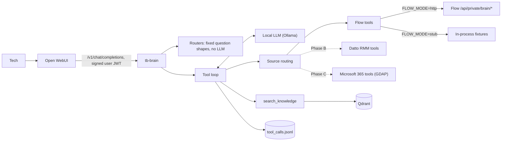

# tb-brain

TechBldrs' local MSP assistant. A tech asks any question about a client we manage; tb-brain works out which
system holds the answer, calls read-only tools on that system, and answers only from what came back. A local
model does all of it, because client data includes PHI.

Today that system is **Flow** (tickets, time, ticket-attached mail, contacts, technicians, clients) plus a
knowledge search over IT Glue SOPs and past fix notes. Next come **Datto RMM** (Phase B) and each client's
**Microsoft 365 tenant via GDAP** (Phase C), then more sources. The plan, the decisions behind it and the
"ready to buy the Mac Studio" checklist are in [docs/end-goal-plan.md](docs/end-goal-plan.md).

It is not a vector dump of Flow. Structured data is reached through named tools, and counts, hours and dates
are worked out in code, not by the model.

## Hard rules

- **Local LLM only.** No cloud model ever sees client data. `LLM_BASE_URL` points at a local
  OpenAI-compatible server (Ollama today).
- **Read-only by default.** The one write is `merge_tickets`. It is chat-only (no `/tools` route), needs
  `confirm=true`, needs the plan shown first and the user's latest message restating both labels, and needs a
  verified Open WebUI identity, which goes to Flow as `X-Brain-Actor-Email`. If any of that is missing, it refuses.
- **Every tool call is audited:** actor, source, tool, client and row ids, in `tool_calls.jsonl` under
  `BRAIN_DATA_DIR`.
- **No passwords or secrets**: never fetched, never put in a prompt, never shown.
- **No runtime data or secrets on OneDrive or in git.** No venv, models, Qdrant data, Docker bind mounts,
  logs or `.env` in this repo.

### Rules for every new source

A new source (Datto RMM, Microsoft 365, ...) follows all of the above, plus:

- **Read-only.** Its protocol has no write methods, and it uses read-only API scopes and roles.
- **Its own credentials.** tb-brain has its own read-only key or app registration. It never borrows Flow's.
  Secrets go only in the runtime box's `.env`.
- **Summaries, not raw data.** Each tool returns a short, capped summary, never a raw API response.
- **Audited.** Its tools go through `run_tool` like Flow's. The source name goes into every audit row
  (`source_name`, e.g. `datto-http`).
- **No secrets in or out.** It never reads passwords, keys, mail bodies, files or chats, and redacts anything
  that looks like a secret.
- **Clients by code or name only.** The model names a client; the tool resolves tenant, site and org ids with
  the client resolver (`app/sources/clients.py`). The model never handles those ids.
- **Off unless enabled** with its `<NAME>_MODE` setting. It has stub fixtures for tests and eval, and its tool
  names carry its prefix (`datto_`, `m365_`).

## How it works



1. Open WebUI sends the chat to tb-brain's OpenAI-compatible endpoint with a signed JWT naming the signed-in
   tech. tb-brain advertises one model, `tb-brain`.
2. A few fixed question shapes are answered by routers without the LLM (`DISABLED_ROUTERS` turns them off).
3. Otherwise the tool loop asks the local model, offering only the tools of the sources the question needs
   (source routing, below). The model calls tools; tb-brain runs and audits each call. Tool results that are
   already formatted lists are shown as they are. Summaries are written by the model, but only from the tool's
   digest, and figures the digest didn't have are removed.
4. Guards: a data question answered with no tool call gets one nudge, then a router, then a forced tool call,
   then a safe "I didn't run a search" message. Ticket labels no tool returned are blocked. Only English
   replies are allowed.

**Source routing** (`SOURCE_ROUTING=on`): Flow and `search_knowledge` are offered on every call. Any other
source is offered when its keywords or patterns match the question, when the conversation already used it, or
when the model asks for it with `use_source`. While only Flow is enabled, routing changes nothing.

**Prompt styles** (`PROMPT_STYLE`): `legacy` sends the full Flow system prompt (the default; it scores best on
the 14B). `lean` sends short general rules plus a section per offered source, with per-tool guidance in the
tool descriptions. It also puts the signed-in tech and the date after the static prefix, so the model server's
prompt cache can reuse that prefix across users.

## Layout

```text
app/main.py            FastAPI: /health, /v1/models, /v1/chat/completions, /tools (+ one route per read tool)
app/agent/loop.py      The tool loop, nudges and fallbacks, English-only gate
app/agent/routing.py   Source routing and the use_source tool
app/agent/system.py    System prompts (legacy, lean base) and the signed-in / date lines
app/agent/wording.py   Loop messages and the must-use-a-tool test, worded from the enabled sources
app/sources/base.py    SourceSpec (what a source is) and Sources (the enabled bundle)
app/sources/registry.py  Which sources are enabled, from <NAME>_MODE settings
app/sources/clients.py   Client resolver: code or name -> client code, M365 tenant id, IT Glue org, Datto site
app/sources/cache.py   Short in-memory TTL cache (client resolver, signed-in technician)
app/sources/<name>/    One folder per source, e.g. app/sources/flow/:
    protocol.py          read-only client interface (no write methods except Flow's gated merge)
    schemas.py           records the tools work with
    stub.py, fixtures.py stub client and fake data for tests and eval (<NAME>_MODE=stub)
    http.py              the real API client (<NAME>_MODE=http)
    factory.py           builds the client for the configured mode
    tools.py             OpenAI tool schemas (lean_tools.py: shorter descriptions for PROMPT_STYLE=lean)
    handlers/            one module per area; dispatch.py maps a tool name to its handler
    prompt.py            the source's section of the lean system prompt
    wording.py           how loop messages name the source, and its data words
    spec.py              the SourceSpec tying the above together, plus routing keywords
app/tools/             Shared tool plumbing: run_tool (validation + audit), ToolResult, formatting, turn
                       parsing, search_knowledge. handlers.py and registry.py re-export for old imports.
app/flow/              Old import path; aliases for app/sources/flow/
app/knowledge/         Qdrant + local embeddings for search_knowledge
app/identity.py        Open WebUI's signed user JWT -> who is asking
app/audit.py           Audit rows
eval/                  Eval cases and question drafts (results/ is gitignored)
scripts/               Run, eval and probe scripts (below)
docs/                  End-goal plan, Open WebUI setup, OpenClaw notes
docker-compose.yml     Open WebUI and Qdrant (named volumes, not bind mounts)
```

Adding a source: create `app/sources/<name>/` with the parts above. Add its `SourceSpec` to `KNOWN_SOURCES`
in `app/sources/registry.py` and a `<NAME>_MODE` setting (default `off`) in `app/config.py`. Give the spec a
`description` and `keywords` / `patterns` so routing can offer it, and a `wording` so loop messages name it.
Add eval cases with `"sources"` expectations.

## Settings

All settings come from env or `.env` (see [.env.example](.env.example)). The ones that shape behavior:

| Setting | Values | What it does |
|---|---|---|
| `FLOW_MODE` | `stub` (default), `http` | Flow is always on. `stub` uses in-process fixtures; `http` calls Flow's read-only brain API with `FLOW_BASE_URL` and `FLOW_API_TOKEN`. |
| `DATTO_MODE` | `off` (default); `stub`, `http` from Phase B | Datto RMM. Reserved: until the source exists, any other value logs a warning and stays off. |
| `M365_MODE` | `off` (default); `stub`, `http` from Phase C | Microsoft 365 via GDAP. Reserved, same as above. |
| `PROMPT_STYLE` | `legacy` (default), `lean` | Full Flow prompt, or short rules plus per-source sections with a cache-friendly order. |
| `SOURCE_ROUTING` | `on` (default), `off` | `on` offers each call only the sources it needs; `off` offers every enabled source every time. |
| `DISABLED_ROUTERS` | comma list | Turns routers off so those questions go to the model: `merge_suggestion`, `person_mail`, `person_ticket`, `tickets_about`, `longest_time`. |

Also: `LLM_BASE_URL`, `LLM_MODEL`, `LLM_NO_THINK`, `LLM_EXTRA_BODY` (model and endpoint),
`AGENT_MAX_TOOL_ITERS`, `BRAIN_HOST` / `BRAIN_PORT`, `BRAIN_DATA_DIR` (logs and audit, default
`%LOCALAPPDATA%\tb-brain`), `BRAIN_USER_JWT_SECRET` (verifies Open WebUI's signed user), `QDRANT_URL`
(empty turns `search_knowledge` off). `/health` reports the active mode, model, prompt style, routing and routers.

## Run

On Windows, from the repo root. The venv lives at `%LOCALAPPDATA%\venvs\tb-brain`, never in the repo.

```powershell
. .\scripts\dev_venv.ps1 -Install   # create/activate the venv and install requirements
copy .env.example .env              # then edit; never commit .env
.\scripts\run.ps1                   # tb-brain on http://127.0.0.1:8765
```

- `GET /health`: modes, model, prompt style, routing.
- `GET /tools`: the tool schemas for the configured style.
- `POST /tools/<name>`: run one read tool directly, no LLM, e.g.
  `curl http://127.0.0.1:8765/tools/latest_ticket -Method POST -ContentType "application/json" -Body '{"client_code":"WDON"}'`
- `python scripts/ask.py "What are my open tickets?"`: ask from the terminal without Open WebUI.

Open WebUI: start Ollama and tb-brain, then `docker compose up -d` and open **http://localhost:3000**. Setup,
Entra sign-in and the signed identity hop are in [docs/open-webui.md](docs/open-webui.md).

Knowledge search (optional): `ollama pull nomic-embed-text`, set `QDRANT_URL=http://127.0.0.1:6333`, restart
tb-brain, then run `python scripts\sync_knowledge.py` with `FLOW_MODE=http` to index IT Glue SOP documents and
time-entry fix notes. The sync isn't automatic yet; rerun it after changes. Passwords are never fetched, and
lines that look like a password are redacted.

## Test

```powershell
python -m unittest discover -s tests
```

Tests are hermetic: `tests/_isolation.py` ignores `.env` and the environment, pins stub Flow, and refuses any
network connection, so they never reach Flow, Ollama or Qdrant and write nothing outside a temp dir.

## Eval

Run these against a running tb-brain with **`FLOW_MODE=stub`**. The cases include write requests, so never
point them at real Flow.

```powershell
python scripts/eval.py run --questions eval/flow_cases.json --label flow-legacy   # 60 Flow cases, scored on tool calls
python scripts/eval.py run --label routers                                         # router regression set
python scripts/eval.py compare eval/results/A.json eval/results/B.json
```

Each result file records the model, prompt style, routing and disabled routers `/health` reported. The case
format is in the `scripts/eval.py` docstring.

- `scripts/live_run.py` asks every question in `eval/live_questions.txt` against **real** Flow
  (`FLOW_MODE=http`). It only reads; the list asks for merge suggestions, never merges. It saves the answers,
  tool calls and timings to check against the database.
- `scripts/probe_cache.py --style legacy|lean` checks whether Ollama reuses its prompt cache across users.
- `scripts/hw_eval.ps1` runs the whole hardware validation on the runtime box (below).

## Runtime box notes

What we learned running tb-brain on the 5060 Ti box (the repo there is a git clone, not this OneDrive copy):

- **Set `OLLAMA_CONTEXT_LENGTH=16384`** for the user Ollama runs as, then restart Ollama. A real call reached
  14,246 tokens. Past the context length, Ollama cuts the prompt and the only sign is a "truncating input
  prompt" line in its server log.
- **Restarting Ollama must also stop its `llama-server` runners.** Stopping only the `ollama` processes leaves
  each runner alive and holding its model in VRAM, so every restart stacks another copy until the model spills
  to CPU. After a restart, `ollama ps` should show `100% GPU`.

  ```powershell
  Get-Process "ollama*", "llama-server" -ErrorAction SilentlyContinue | Stop-Process -Force
  ```

- **Open WebUI's background tasks skip the tool loop.** Chat titles, tags, follow-up suggestions, search-query
  generation and autocomplete sent to `tb-brain` go straight to `LLM_BASE_URL` with no tools, no system prompt
  and no Flow calls (`app/agent/passthrough.py`; `x_tb_brain` says `"task_passthrough": true`). tb-brain spots
  them by Open WebUI's task templates (a lone user message starting `### Task:` with a `<chat_history>` block).
  To mark them explicitly, add the header `X-OpenWebUI-Task` with the value `{{TASK}}` to the tb-brain
  connection in Admin Panel → Settings → Connections. Setting the Task Model (Admin Panel → Settings → Interface)
  to a plain Ollama model also still works.
- **Open Open WebUI at `http://localhost:3000`**, not `127.0.0.1` or the box's IP. Entra matches the redirect
  URI exactly, and it is registered for `localhost`.
- **`scripts/hw_eval.ps1`** runs the A4 validation in one go: the Flow eval in both prompt styles at 8K and 16K
  context, the cache probe, and the comparisons. Stop tb-brain first; the script starts it itself and refuses
  to run if it's already up. It sets `FLOW_MODE=stub` for the run and stops if `/health` reports anything else.
  It restarts Ollama per context size (runners included) and puts `.env` and `OLLAMA_CONTEXT_LENGTH` back
  afterwards, even on failure. Output goes to
  `%LOCALAPPDATA%\tb-brain\hw-eval\<timestamp>\`; `summary.txt` is the part to paste back. Start tb-brain
  again afterwards.

  ```powershell
  .\scripts\hw_eval.ps1
  ```

- **Optional: run production from a separate worktree pinned to a tag**, so a `git pull` for testing doesn't
  change what the techs are using:

  ```powershell
  git tag prod-2026-10-13 <commit>; git push origin prod-2026-10-13
  git worktree add C:\src\TechBldrs-Brain-prod prod-2026-10-13   # detached at the tag
  # give it its own .env (FLOW_MODE=http); test checkouts use another BRAIN_PORT
  # to upgrade: git -C C:\src\TechBldrs-Brain-prod checkout <newer tag>, then restart it
  ```

## Flow data model (do not guess)

From Flow's `app/models/`:

- **clients**: `client_code` is unique (e.g. `WDON`). The client detail carries `m365_tenant_id` and `itglue_url`.
- **contacts**: `full_name`, `email_1/2/3`, `contact_type`, optional `client_id`.
- **tickets**: `ticket_num` is 4 characters; the label is `{client_code}-{ticket_num}`; activity comes from
  `last_activity_at`.
- **mail**: always filed on a ticket (`ticket_id`). `direction` is `inbound`, `outbound` or `imported`. Flow
  mail is not a live mailbox.

tb-brain reaches Flow only through `/api/private/brain/*` with `PRIVATE_API_TOKEN` (see Flow's
`app/routes/private_api.py`). It has no database access, and the model never sees SQL. Stub fixtures follow the
same shapes, with fake people and a few real client codes so the example questions work.
